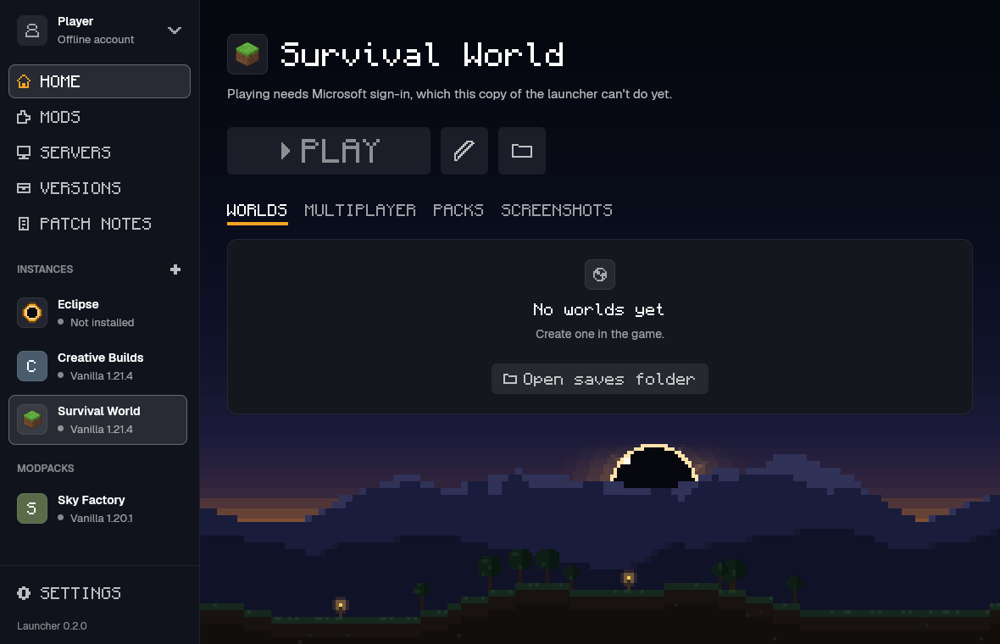
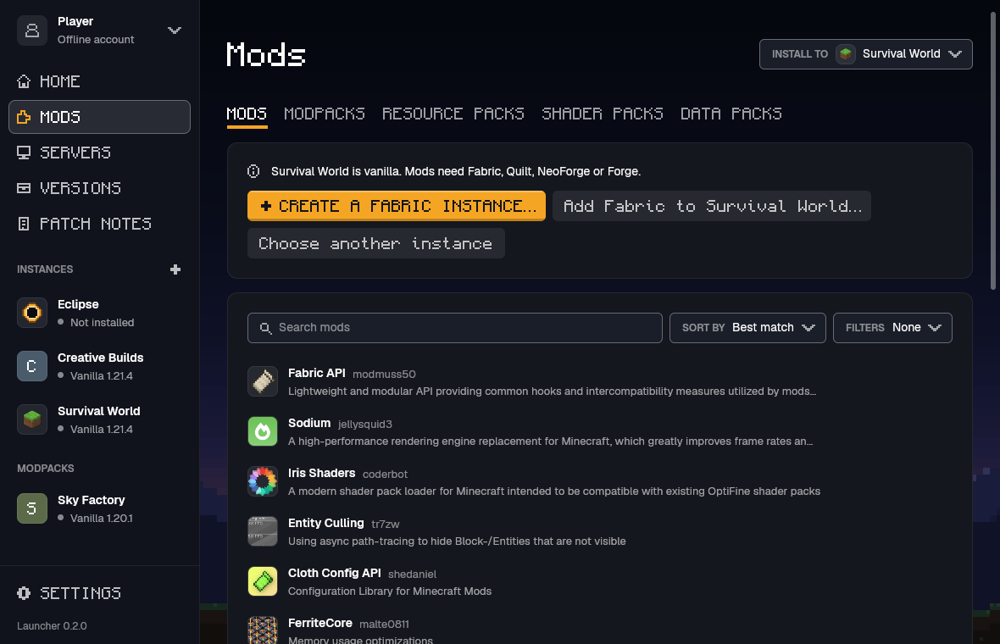
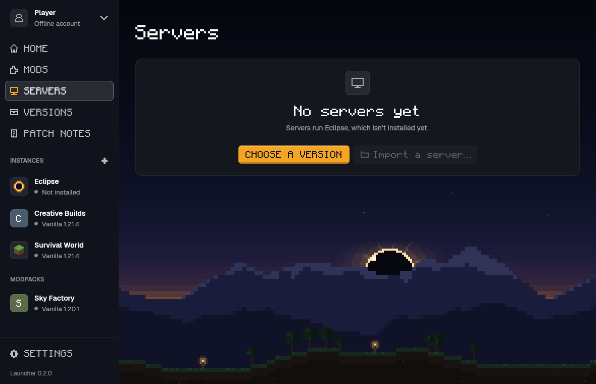
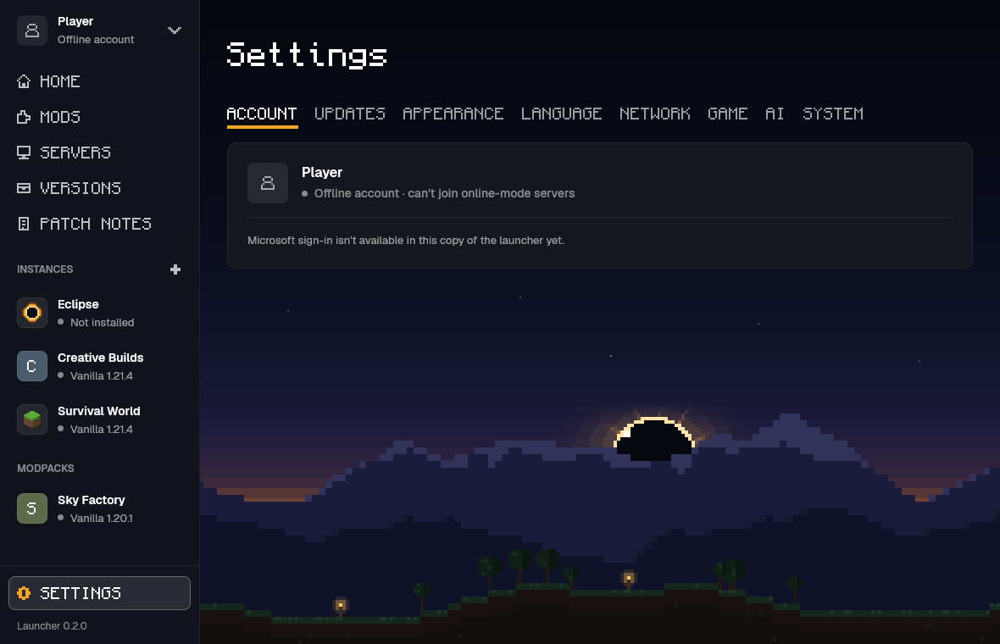
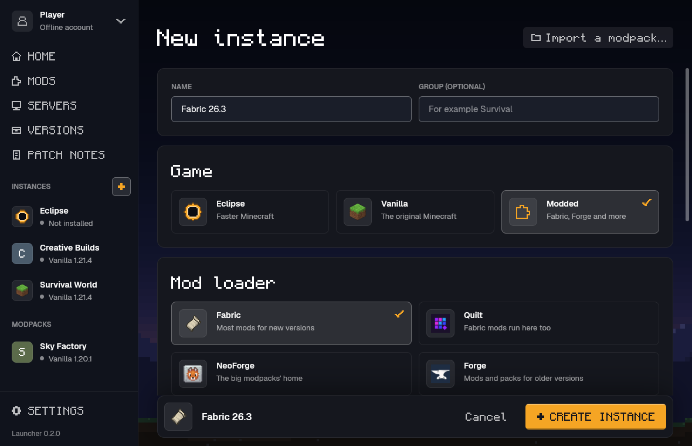
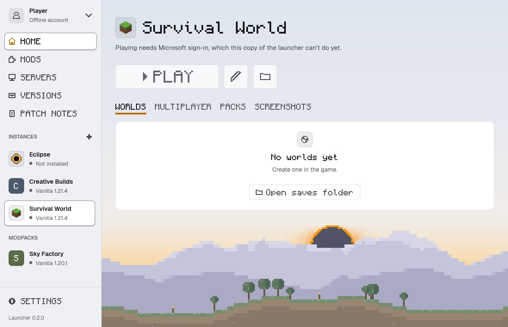

# Eclipse launcher

A small desktop app that installs Eclipse builds, prepares them from your own copy of
Minecraft, and starts the client or a dedicated server. Built with [GPUI Fast](https://github.com/longbridge/gpui-fast),
a fork of Zed's UI framework [GPUI](https://www.gpui.rs) that draws unchanged views from the last frame;
it has its own Cargo workspace and is not part of the game's builds.



## What it does

- **Versions**: lists the published builds of Moonistics/Eclipse (the current Nightly, the last
  week's, then the releases from before), installs the build for this platform into its own
  folder, and removes it again. **Import a version from file…** takes a `eclipse-client` you have (one
  built on your fork's Actions, or the zip holding it) and installs it as `imported-<date>-<sha>`:
  a copy of the selected release or Nightly's folder, game files included, with that program as the
  game. Imported builds are listed apart as unsigned, and no update replaces them.
- **Play**: prepares resources as `PLAY.txt` describes (your launcher's 26.3 install, the
  26.3 server jar from that version's own json, and Java 25) and copies its sounds from your
  launcher's asset store (`eclipse-prepare sounds`; a launcher install without them only
  leaves the game silent), then starts the client. Preparing is
  eclipse-prepare: linked into the launcher, used in-process when a version ships the same
  preparer sources, else that version's own `eclipse-prepare`; versions released before it
  still prepare with their Python script and need Python 3.10+. Before importing,
  preparation reuses checksum-verified game jars and libraries from the current
  or another installed Eclipse version, so the original Minecraft install is
  only required when no valid imported copy exists.
- **Download and prepare**: for a signed-in account that owns the game (asked again first),
  the launcher downloads the pinned version from Mojang itself (piston-meta, piston-data,
  libraries.minecraft.net, resources.download.minecraft.net; never a mirror) into `minecraft/`
  in its data folder, in the official launcher's layout: the version file, the client jar, this
  system's libraries, the asset index and the assets. Every file must have the size and sha1
  Mojang lists. Home shows how far it is under Play; files already whole are kept, so the next
  try goes on from there. **Play** on a version not prepared yet does it all for an owner, as the
  official launcher does: it prepares from the player's own launcher install when there is one
  (**Choose Minecraft folder…** in Play's menu, or Settings' Minecraft folder, picks another),
  else downloads (with Mojang's Java when no Java 25 is installed), then starts the game; an
  install that lacks the version falls back to the download. Without an owner, Play asks to sign
  in first. `eclipse-launcher prepare --download`.
- **Mods**: tabs for Mods, Modpacks, Resource packs, Shader packs and Data packs. Mods, Modpacks,
  Resource packs and Data packs (into the world picked there) search Eclipse's own registry, with
  its categories as filters, or Modrinth (CurseForge support is coming soon); Shader packs search
  the registry. A Java
  instance's files come from Modrinth for its version and loader; on a Eclipse instance, Modrinth's
  Java mods are listed too, each marked Works, Partly or Doesn't run in Eclipse. Install puts a file in
  the game folder only after its SHA-512 matches, and a
  modpack goes to the Modpacks page; installed packs show their source and checksum, with Update,
  **Update all** and Remove ([docs/mod-browser.md](../docs/mod-browser.md)).
- **Modpacks**: import a Java modpack (a Modrinth `.mrpack`, a CurseForge zip, or a Prism,
  MultiMC or CurseForge instance folder) and see its coverage report: per mod, ported, partial,
  not yet or not needed, with the reason ([docs/modpacks.md](../docs/modpacks.md)). **Port**
  gets the jars of what this computer can port today (content mods with data and assets only)
  the player's own way: copied from a folder they have, or downloaded from the pack's own links
  or the same file on Modrinth's CDN, hash checked; files only CurseForge has come from your
  installed instance (CurseForge downloads are coming soon). It carries them over for the selected version, and
  **Play** starts the game as the pack's own profile (`ports/<pack>/home/` in the game's home:
  its own saves and options) with those mods. Nothing is uploaded or shared: mod jars and ports
  stay on this computer.
- **Servers**: host a world for friends with buttons. **Create a server** asks for a name, a world
  (a new one, with an optional seed, or a copy of one of your single-player worlds), the game mode,
  difficulty, most players, who can join (friends only, the default, or anyone with the address)
  and your agreement to the Minecraft EULA; with the defaults (tick the EULA, press Create) you get
  a friends-only survival world with you as its operator. Each server then has **Start**, **Stop** and **Restart**, its state (also
  when it crashed and was restarted), players online with their heads, TPS, MSPT and RAM, the
  address friends on your network type with **Copy the address**, a console that takes commands,
  **Open the web panel**, and three tabs: **Players** (online players with Make operator, Kick
  and Ban; who can join, with Friends only and its list; Unban); **Settings** (the message
  in the server list, game mode, difficulty, PvP, most players, view and simulation distance,
  port, account checks, **Run in the background and at login**); **Backups** (Back up now, the
  list with dates and sizes, Restore with a confirmation, Back up automatically, and **Updates**:
  Check for updates, Update now with its automatic rollback, and how many older versions to
  keep). Changes the running game can take apply at once, the others say "Restart to apply".
  Everything goes through `eclipse-server` itself ([docs/hosting.md](../docs/hosting.md)):
  the launcher copies a prepared version's programs and game files into `server-runtime/` laid
  out as `install.sh` does, runs `eclipse-server init`, `config`, `start`, `backup`, `restore`,
  `update` and `service` there, and talks to a running server through its control API. Problems
  are said in plain words, with a button when there's a fix (another port, the game files, the
  EULA).
  **Over the internet** uses Tailscale: it says whether Tailscale is installed and signed in (with
  Install Tailscale, Sign in to Tailscale and Check for Tailscale again; signing in is always
  yours, in Tailscale's own app or page), shows this computer's Tailscale name and address with
  **Copy the address**,
  and invites a friend to this one computer: in the admin console, or here with an access token
  you make there (kept in the system keychain), which also lists invitations with Withdraw /
  Stop sharing and offers **Limit them to Minecraft**: when your tailnet has Tailscale's default
  access controls, one click changes them so friends you share with reach only the server's
  port (Remove the limit undoes it); custom access controls are never rewritten, the page gives
  the rule to add instead. Eclipse never turns on Funnel.
- **Instances**: separate game folders, each with its own worlds, options and packs. The game's
  folder stays the first one, "Eclipse", exactly where it was; imported and registry modpacks are
  instances too, in their own folders as before; new ones go to `instances/<name>/` in the game's
  folder, empty but for the player's options and name, or a copy of another instance (never its
  sign-in sessions, logs or data collection state). Names, icons (a block or item texture from the
  player's prepared files, or a colour) and groups are kept in `instances.json` in the launcher's
  data folder, so renaming moves nothing. Every instance follows the launcher's data collection
  answer and No AI. In the window, **New instance** in the sidebar makes one, the sidebar lists
  them by group (click one to play it), and each one's menu (⋯) has **Edit…** (name, group, icon),
  **Duplicate…** and **Open instance folder**. Home shows its play time and when it was last
  played: every run started from the window or `eclipse-launcher play` adds to it (`instance list`
  shows it too). Each instance plays the launcher's version, which follows updates, unless Home's
  Version list keeps it on another installed one (to keep an old world on the version it was made
  with); picking **Always the newest** lets it follow again.
- **Export**: an instance's menu has **Export…**: the instance (or a port) as a `.mrpack`
  (Modrinth's modpack format: resource packs the browser installed from Modrinth are listed by
  their download, the rest is in `overrides/`) or a `.zip` of the game folder's layout, with the
  worlds switched on. It is written to `exports/` in the launcher's data folder (**Show in
  folder**). Only settings (options.txt, eclipse-*.txt, servers.dat), resource and shader packs,
  `eclipse-mods/` and `config/` go in: never logs, screenshots, backups, caches or account files;
  a world goes without `playerdata/`, `stats/` and `advancements/`, and its level.dat without the
  player's UUID. `eclipse-launcher instance export [<instance>] [--format mrpack|zip] [--world
  <w>]… [--out <file>]`.
- **Import by dropping a file**: a file dropped anywhere on the window is imported for what it is
  (`eclipse_launcher::import`). A shared instance (a `.mrpack` that needs no mod loader, such as
  Export writes, or a game folder `.zip`) becomes a new instance, opened on Home. Its `.mrpack`
  downloads come from Modrinth with their SHA-512 checked, and only what an instance keeps is
  taken, inside its folder. A Java modpack goes to the Modpacks import, and a resource or shader
  pack into the selected instance. A data pack is pointed at the world rows, and the Packs section
  and the world rows keep taking their own drops. A note in the corner says what happened.
  `eclipse-launcher instance import <file>`.
- **Maximum memory** (Java instances): set the Java heap limit (`-Xmx`) with the slider or
  a value such as `4096` or `4gb`. Leave the box empty to restore the default (4096 MB).
  It is on the instance's Edit page.
- **Launch options**: on an instance's Edit page (its menu's **Launch options…** opens it there):
  per instance, a shell command run in its
  folder before the game (the game starts only if it succeeds), a wrapper the game runs through
  (`nice -n 5`), and environment variables (`NAME=value OTHER="two words"`), kept in
  `instances.json` (`eclipse_launcher::launch`). The game stays one process the launcher follows:
  on Unix `/bin/sh` runs the command and then `exec`s the wrapper and the game, whose words pass
  through `"$@"` untouched; on Windows `cmd /C` runs `<command> && <game>`. Both the window's Play
  and `play` use them. `eclipse-launcher instance launch <instance> [--pre-launch …]
  [--wrapper …] [--env …]` (an MCP agent needs `confirm: true`: it sets commands Play runs).
  On Linux the section also has switches for what the computer has: **GameMode** (`gamemoderun`
  on the PATH), **MangoHud** (`mangohud`), and, with two graphics cards under
  `/sys/class/drm`, the **dedicated graphics card** (`DRI_PRIME=1`, or NVIDIA's
  `__NV_PRIME_RENDER_OFFLOAD`, `__VK_LAYER_NV_optimus` and `__GLX_VENDOR_LIBRARY_NAME` when its
  driver is loaded). A switch whose tool is gone does nothing. `instance launch --gamemode
  on|off --mangohud on|off --dedicated-gpu on|off`; `ECLIPSE_LAUNCHER_LINUX_TOOLS` makes any
  system show them, for tests.
- **Desktop shortcut**: an instance's menu has **Create a desktop shortcut**: a shortcut on the
  desktop that plays the instance without opening the launcher (`eclipse-launcher play --instance <id>`).
  A `.desktop` file on Linux (also put in the applications menu, and marked trusted with `gio`
  where it exists), a small app with Eclipse's icon on macOS, a `.lnk` on Windows
  (`eclipse_launcher::shortcut`). **Remove the desktop shortcut** moves it to the trash; it is found by the
  instance id inside it, so a rename doesn't lose it. `eclipse-launcher instance shortcut
  [instance] [--remove]`; `ECLIPSE_LAUNCHER_DESKTOP` points it at another folder.
- **Accounts and quick switch**: the account at the top of the sidebar opens a menu of everyone who can play:
  each signed-in Microsoft account, the offline names the player keeps, and the name the game
  made up (`eclipse-player.txt`). Picking one plays as it from the next Play. Offline names play
  only while an account that owns the game is signed in ([Microsoft accounts](#microsoft-accounts));
  signing the last one out keeps them, unplayable until one is back. Settings > Account
  adds offline names (3 to 16 letters, digits or `_`; the game gets `--name`) and forgets them,
  skin and cape files included, and rolls the game's made-up name for a new one; the Console's
  Share log takes the names out of the log too. `eclipse-launcher account offline
  [NAME]`, `account select <name>` (an account or an offline name), `account forget-offline
  <name>`.
- **Accent and Home background**: on top of Dark, Light or System, Settings > Appearance picks an
  accent (Eclipse's amber, blue, teal, green, violet, red or pink, any hue, or any colour typed as
  hex) and a picture of the player's own behind Home (PNG, JPEG or WebP, cropped to fill; **Default
  background** brings Eclipse's back). The dark look wears the colour as is; the light look keeps
  it as the fill and darkens it for icons and ticks until they read at 3:1, and for links and the
  focus ring until they read at 4.5:1, on every light background. The label on the accent turns
  dark when the accent is light (tests hold every accent the picker makes to it). The picture is
  copied into the data folder. `eclipse-launcher settings accent NAME|#rrggbb|DEGREES`,
  `settings background PATH|default`.
- **Language**: English and every language with a table in `launcher/lang/<code>.json` (English
  text to its translation, Eclipse's own). The window follows the system's language unless the
  player picks one in Settings > Language (each named in itself); a string a table lacks shows in
  English. A test fails when the code asks `tr("…")` for a string a table lacks, or a table keeps
  one the code dropped. `eclipse-launcher settings language system|<code>`.
- **Skin and cape**: each offline name's **Change skin** in Settings > Account shows the front of its
  skin and cape, takes a skin PNG (64×64, or the older 64×32) and a cape PNG (64×32), and picks
  classic or slim arms. The launcher keeps copies in its `skins/` folder and gives the game
  `ECLIPSE_OFFLINE_SKIN`, `ECLIPSE_OFFLINE_SKIN_MODEL` and `ECLIPSE_OFFLINE_CAPE` when that name
  plays; the game draws the default skins until it reads them. A Microsoft account's skin and
  cape: coming soon, with sign-in. `eclipse-launcher account skin <name> [FILE] [--model
  classic|slim] [--cape FILE] [--no-skin] [--no-cape]`.
- **Console**: Home's Console shows the game's output of this run as it comes: **Search the log**
  (every word, any case), **Auto-scroll** to keep the newest line in view, **Copy log**, and **Open
  logs folder**. Warnings
  and errors stand out. **Share log…** uploads the log to [mclo.gs](https://mclo.gs), a paste
  service for Minecraft logs, only after the player confirms; the home folder, the user name and
  the account names are taken out first (`eclipse_launcher::game_log`), and **Delete upload** removes
  the paste. `eclipse-launcher share-log [--instance]` and `unshare-log <id:token>`;
  `ECLIPSE_LAUNCHER_PASTE_URL` points it at a test server.
- **Worlds**: Home lists the selected instance's worlds (picture, mode, version, last played,
  size). **Back up world** zips one into the instance's `backups/` as the game's Make Backup does
  (`<date>_<time>_<folder>.zip`); **Duplicate world** puts "<name> (1)" beside it; **Delete…**
  moves it to the system's trash after a confirmation; **Open world folder**. The same from the
  command line:
  `eclipse-launcher worlds [list|backup|copy|delete] [--instance <name>]`.
  **Play** on a world starts the game straight into it. **Show data packs** opens the world's
  `datapacks/` under its row: what is there (and which the game has turned off), **Add data pack…**,
  and **Delete…** (to the trash); a data pack `.zip` dropped on a world goes into it. The game turns
  a new one on when the world opens. From the command line: `eclipse-launcher worlds
  datapack-list|datapack-add|datapack-remove <world> …`. The Mods page's **Data packs**
  tab finds them on Modrinth and installs one into the world picked there (`mods search --kind
  datapack`, `mods install <pack> --world <world>`), saying what of it runs in Eclipse.
- **Packs**: Home lists the selected instance's resource packs and shader packs, each with a switch.
  The choice is the game's own: `resourcePacks` in options.txt (a pack turned on goes on top, as
  the game's Resource Packs screen does) and `pickedShaderPack` in `eclipse-graphics.txt` (one shader
  pack at a time). **Add from file…** or a `.zip` / `.eshader` dropped on the section copies it into
  the right folder; **Delete…** turns it off and moves it to the trash after a confirmation. From the
  command line: `eclipse-launcher packs [list|add|on|off|remove] [--kind resource|shader]
  [--instance <name>]`.
- **Screenshots**: Home shows the selected instance's newest screenshots (what F2 saves in its
  `screenshots/` folder) and all of them on request. Clicking one opens it over the window (← and →
  step through) with **Copy** (the picture, to the clipboard), **Open**, **Show in folder** and
  **Delete…** (to the trash, after a confirmation). From the command line:
  `eclipse-launcher screenshots [list|delete] [--instance <name>]`.
- **Java** (for the Minecraft: Java Edition instances to come): the runtime a version's JSON asks for
  (`javaVersion`: its major exactly, Java 8 before that field), found among Mojang's runtimes Eclipse
  downloaded (`minecraft/runtime/` in its data folder, the one preparing uses) and the Java homes installed
  on this computer, read from their `release` files without starting them; when none has that major,
  Mojang's runtime is downloaded; an instance may name its own Java home instead.
  `eclipse-launcher java [list|install]`.
- **Multiplayer**: Home lists the selected instance's servers, the game's own Multiplayer list
  (`servers.dat`, each with the picture the game last saw). **Join** starts the game straight into
  one; **Add server** and **Remove…** (after a confirmation) change the file the game reads,
  keeping every field the launcher doesn't show and the servers joined with Direct Connection. The
  same from the command line: `eclipse-launcher multiplayer [list|add|remove] [--instance <name>]`
  and `eclipse-launcher play --server <address or name>`.
- **Patch notes**: each release's notes, newest first, with a link to GitHub Sponsors. Quiet "Sponsor", "Discord" and "Website" links sit in the sidebar footer.

Data lives in the platform's data directory (`~/.local/share/eclipse-launcher` on Linux,
`~/Library/Application Support/eclipse-launcher` on macOS, `%APPDATA%\eclipse-launcher` on
Windows): `versions/<tag>/`, `server-jars/`, `server/`, `settings.json`, and for the Servers
page `servers.json` (the list), `servers/<name>/` (the servers created there) and
`server-runtime/` (the programs and game files they run).

- **Settings**: install new Eclipse versions automatically (on unless you turn it off; the
  selected version only moves to the new one if you were on the newest), the opening animation,
  what the window does while you play (stays by default; Minimise, or Hide on macOS, puts it away
  when the game starts and brings it back to the front when the game closes; `settings
  while-playing stay|minimize|hide`), the game's extra command-line arguments, an HTTP proxy for
  downloads, and the launcher's own version and update state. On Windows ARM, **Game
  architecture** chooses Automatic, x64 or ARM64 independently from the launcher; automatic
  preserves the launcher's architecture, and a release without ARM64 uses the signed x64 build.
  A changed choice reinstalls the selected version when automatic updates are on, and the game
  won't launch an installed build that conflicts with a manual choice. `eclipse-launcher settings
  game-architecture auto|x64|arm64`.
- **Updates**: Eclipse ships only the Nightly (since 2026-10-28, docs/release-flow.md). The
  launcher installs the current one (the `nightly` pre-release, checksums signed for the Nightly
  channel) as `nightly-<date>-<commit>` and selects it when the player was on a Nightly, on the
  newest release or on nothing; a version picked by hand or pinned by an instance stays, and so
  does an imported build. Older
  Nightlies are removed once nothing plays them. Worlds are never touched: they live in the game's
  folder, not in a version's. The last week's Nightlies (`nightly-<date>`), the `vX.Y.Z`
  releases and the old Alpha pre-releases stay on the Versions page to install by hand, never as
  an update. The "Nightly builds" setting and its `nightly` key are gone (an old key is ignored);
  its "Nightly" instance stays and keeps following the Nightly. The `update_channel` and
  `beta_builds` keys older launchers wrote are ignored and dropped on the next save.
- **Game arguments**: extra arguments added to the game's command line (for example
  `--server-thread`), one line where quotes group a word with spaces. They are appended after the
  launcher's own arguments, kept as `game_args` in `settings.json`, and apply the next time the
  game starts. `eclipse-launcher game-args "<line>"` sets them too, and `play --arg <ARG>` passes
  one for a single run.
- **Proxy**: when the internet here needs one (a school's, an office's, a country where a host is
  unreachable), Settings > Network's Proxy address takes the `http://host:port` or
  `socks5://host:port` address your proxy app listens on, and every download goes through it: Eclipse's releases and the launcher's own update, Minecraft's
  files and Java from Mojang, Modrinth, CurseForge, Eclipse's mod registry, pictures, Microsoft
  sign-in, and the jars a modpack import fetches. It is kept as `proxy` in `settings.json`, and
  `eclipse-launcher settings proxy http://127.0.0.1:7890` sets it too ("default" removes it).
  Without one, `HTTPS_PROXY` and `HTTP_PROXY` are used when the launcher is started with them, and
  `NO_PROXY` names the hosts to reach directly, a modpack import's jars included. A server on this
  computer never goes through it.
- **Links**: the Discord invite, the Sponsors page and the website come from `launcher/links.json` on main
  (`{"discord": "...", "sponsor": "...", "website": "..."}`), so they change without a launcher release. Offline,
  the launcher uses the same values built in; an empty address hides its button.

Long pages, dialogs, the server console and data previews have a visible scrollbar when
their content overflows. Drag the thumb or click the track to navigate without a mouse wheel.

Pages and Home's landscape fill the window as it resizes. Windows uses a matching title
bar with native dragging, resizing, Snap,
minimize, maximize/restore and close; macOS and Linux keep their system title bars.

## Updates

The launcher looks for a newer Nightly when it starts and every 30 minutes while it is open, and
shows a small "available, Install" line on Play.

Release lists and commits come from GitHub's API, which allows 60 anonymous calls an hour per
address: players behind a shared one (a school, a dorm, a carrier's NAT) spend them together.
So each answer is kept in `cache/github/` in the data folder and used again for 5 minutes without
asking, then revalidated with its ETag. When GitHub answers with its rate limit, or not at all,
Eclipse's own releases are read through the read-only mirror `ECLIPSE_GITHUB_MIRROR` names (none by
default); when both fail the last saved answer is used, else the error names both. The release files
themselves come from their download links, which that limit doesn't cover.

It also updates itself from GitHub releases tagged `launcher@X.Y.Z` (the game's are `nightly`, and
`vX.Y.Z` before 2026-10-28; neither is ever taken for the other). Before 0.2 they were `launcher-vX.Y.Z` and `vYYYY.MM.DD`:
every 0.2 tag counts as newer than all of those (docs/versioning.md). It downloads the new build, checks it
against the release's signed `SHA256SUMS`, and says "A new version is available" in the sidebar with
**Update**: the window closes, the launcher's own file runs again as the installer (`apply-update`,
`src/update_handoff.rs`), which waits for the window's process to exit, puts the new launcher in place (the
binary, the `.app` bundle or the AppImage) and starts it. Closing the window with an update downloaded installs
it the same way, so the next start is the new launcher. When the installer can't put it in place, the old
launcher starts again and says why. Each process stages in its own folder, and the installer checks the signed
SHA-256 again before anything goes in; when the launcher in place is already that version or newer, it changes
nothing. Servers keep running through **Update**. A copy that can't replace itself says so at once and offers
**Download again** (the website's install page): one in a read-only folder (the disk image, or the read-only copy
macOS runs a downloaded app from until it is moved to Applications), or on Windows one running from the temporary
folder, as a program opened inside a `.zip` does. `eclipse-launcher update` replaces it at once. Development builds and
`ECLIPSE_LAUNCHER_NO_SELF_UPDATE=1` never replace themselves.

On Linux the release also comes as an AppImage, `eclipse-launcher-linux-x86_64.AppImage`: one file
to download, make executable and run, with no installation and no `libfuse2` (its runtime mounts
the image where FUSE 2 is there and unpacks it where it is not). It is the same binary as the
`.tar.gz`, with the libraries GPUI needs beside it; glibc, the graphics drivers and the session's
D-Bus stay the machine's, so it needs glibc 2.35 or newer (Ubuntu 22.04, Debian 12, Fedora 36 and
newer). A launcher running from one replaces the AppImage itself when it updates
(`$APPIMAGE`), and the menu entry it writes starts the AppImage rather than the copy inside the
image, which is gone when the launcher exits.

On Linux a release build that starts writes its applications-menu entry only when there is
none, or when the program the entry starts (its `TryExec`, else its `Exec`) no longer exists.
An entry pointing at another launcher that works is left alone, so a test or development build
never takes it over. Turning the Settings switch on, or `eclipse-launcher desktop-entry`,
points the entry at this launcher whatever is there.

Linux packagers can set `ECLIPSE_LAUNCHER_DESKTOP_EXEC` to a wrapper's absolute path.
Menu entries the launcher writes then start that wrapper, which can
set `ECLIPSE_LAUNCHER_NO_SELF_UPDATE=1` to keep launcher updates with the package manager.

Launcher releases are automatic (docs/release-flow.md in the repository): when main changes the
launcher, `eclipse-prepare` or `eclipse-theme`, the `launcher` workflow builds Linux, macOS, Windows x64 and
Windows ARM64 and publishes `launcher@X.Y.Z` (the next patch, or the next minor after a pull request
labelled `feature`) with `eclipse-launcher-linux-x86_64.tar.gz`,
`eclipse-launcher-linux-x86_64.AppImage`, `eclipse-launcher-macos-arm64.zip`,
`eclipse-launcher-macos-x64.zip` (Intel Macs), `eclipse-launcher-windows-x64.zip` and
`eclipse-launcher-windows-arm64.zip`, never marked latest. The version is built in from the tag
(`ECLIPSE_LAUNCHER_VERSION`); `Cargo.toml`'s version is only what local builds report.

Windows also publishes `eclipse-launcher-setup.exe` (x64) and `eclipse-launcher-setup-arm64.exe`: the launcher's own
binary under another name, which opens
a per-user setup instead of the window (no administrator). It copies itself to
`%LOCALAPPDATA%\Programs\Eclipse Launcher\eclipse-launcher.exe`, makes the Start menu shortcut (and the
desktop one if asked) and an entry in *Apps & features*, then starts the copy. `eclipse-launcher-setup.exe
setup --quiet [--dir <folder>] [--desktop-shortcut]` does the same without a window, and
`eclipse-launcher.exe uninstall` (or `... uninstall --quiet [--remove-data]`) takes it all away again: the
shortcuts, the registry entries and the install folder. The game's folders are never touched, and the
launcher's data folder only with `--remove-data`. An installed launcher keeps updating itself, so the
uninstaller at that path is always the newest one.

## Command line

Generate shell completions without opening the window:

```sh
eclipse-launcher completions bash > eclipse-launcher.bash
eclipse-launcher completions zsh > _eclipse-launcher
eclipse-launcher completions fish > eclipse-launcher.fish
```

Elvish and PowerShell are also supported (`completions elvish` and
`completions powershell`). Source the generated script from your shell configuration,
or install it in your shell’s completion directory. Packagers can generate these
files at build time and install them in the corresponding system directories.

The same binary is a command-line tool; without a subcommand it opens the window. On Windows it
is a windowed program, so a desktop start opens no terminal; a subcommand writes to the terminal
it was typed in, or to the pipes and files it was given (MCP keeps its stdio). Interactive `cmd`
and PowerShell don't wait for a windowed program: they show the prompt again before its output
and don't set `%ERRORLEVEL%` / `$LASTEXITCODE`. Scripts that need the exit code use
`start /wait eclipse-launcher …` or `Start-Process -Wait`, or read its output through a pipe.

Every command, its arguments and its MCP tool are in [docs/launcher-commands.md](../docs/launcher-commands.md),
generated from the CLI's definition (a test fails when it is out of date). `--json` prints JSON where
there is something to report. Errors go to stderr with exit code 1. `server` runs in the terminal,
so lines you type reach its console. `ECLIPSE_LAUNCHER_HOME` replaces the data folder (for
scripts and tests). Test runs also set `ECLIPSE_LAUNCHER_TRASH=<folder>` and
`ECLIPSE_LAUNCHER_CLIPBOARD=<file>` inside their scratch folders: what Delete would move to the
system's trash goes into that folder, and what Copy would put on the clipboard is written to that
file, so a test never touches the real trash or clipboard.

## AI agents (MCP)

`eclipse-launcher mcp` is a Model Context Protocol server over stdio. `eclipse-launcher
agent-config` prints the config for Claude Code, Codex, Cursor and any MCP client, and the
command that adds it; for Claude Code:

    claude mcp add --scope user eclipse -- eclipse-launcher mcp

(with the full path to the binary if it is not on your `PATH`). Every CLI command is a tool of the
same name and arguments, generated from the CLI's definition (`src/cli_tools.rs`): `versions`,
`install`, `remove`, `prepare`, `settings`, `mods_search`, `mods_install`, `modpack_import`,
`servers_create`, `data_status`... A call runs that command with `--json` and returns its
output. Tools that delete something (`remove`, `mods_remove`, `modpack_remove`,
`servers_forget`, `account_sign_out`, `data_delete`) need `confirm: true`. The session runs a few
itself, under the CLI's names: `play`, `server` with `server_command`, `server_log` and
`server_stop`, `account_list` and `account_sign_in` (returns the link and code for the player;
the sign-in finishes in the background). A server started through MCP stops (cleanly, with
`stop`) when the session ends. Starting one needs `accept_eula`, which an agent should only pass
with the player's consent.

The same server also plays the game: `play` starts it with a local control socket (`world`,
`creative`, `join` and `offscreen` are optional), and every `eclipse-ctl` tool of the selected
version is offered as `game_<name>`: `game_state`, `game_ui` (every widget of the open screen),
`game_click`, `game_goto`, `game_break`, `game_inventory`, `game_screenshot` (an image) and the
rest of [eclipse-ctl's commands](../docs/eclipse-ctl-commands.md). The launcher runs that
version's `eclipse-ctl mcp` and passes the calls through; while no game runs, they answer with an
error saying to call `play`.

`eclipse-launcher no-ai on` (the Settings page's No AI switch) hides and turns off every AI
feature: `mcp` and `agent-config` refuse, the game opens no control socket and `eclipse-ctl`
refuses. Every other command keeps working.

The window, the command line and the MCP server all call the same library (`src/lib.rs`).

## Microsoft accounts

The launcher starts the game only while a Microsoft account that owns Minecraft: Java Edition is
signed in, as other launchers do: without one, Play (Home, instances, `eclipse-launcher play`, the
MCP's `play`) says "Sign in with a Microsoft account that owns Minecraft: Java Edition to play"
and starts nothing. Settings → Account signs in: the launcher shows a code, you enter it at
microsoft.com/link, and the launcher checks that the account owns the game. It asks again at every
Play, with the token renewal; with no network the last answer stands, and a "doesn't own" blocks
at once. The account also plays online-mode servers under your own name and skin; offline names
play LAN and offline-mode servers beside it. The game binary started directly (`eclipse-client`,
`eclipse-ctl launch`), the harnesses and the servers don't go through this check. Tokens live in the system keychain (Keychain,
Credential Manager, or the Secret Service on Linux), never in a log or the command line;
`accounts.json` in the data folder keeps only names and UUIDs. On Linux without a keychain they go
to `account-secrets.json` in the data folder, encrypted and readable by you only, and back to the keychain once it
answers; on macOS and Windows without one you stay signed in until the launcher closes. The
Tailscale access token never goes to that file: without a keychain it lasts until the launcher
closes. When the game starts, it gets the session in a private file it
deletes as soon as it has read it. Sign out removes the tokens.

Sign-in needs Eclipse's own Azure app registration: its client ID is built in from
`ECLIPSE_MSA_CLIENT_ID` (and `ECLIPSE_MSA_CLIENT_ID` at run time overrides it; empty = not
configured). How it works: [docs/microsoft-account.md](../docs/microsoft-account.md).

## Logs and crash reports

The game writes its log to `logs/latest.log` in the game folder (`ECLIPSE_HOME`, else
`~/.local/share/eclipse`, `~/Library/Application Support/eclipse` or `%APPDATA%\eclipse`), and
archives the previous one at start as `logs/<date>-<n>.log.gz`, as Minecraft does. When it
crashes it writes `crash-reports/crash-<date>_<time>-client.txt` beside them. When a game the
launcher started crashes, Home says so, with buttons to open or copy the report, open the
logs folder and report it on Discord; Settings has the logs folder too. A crash report leaves the
machine only if you turn on crash reports (below).

## Data collection

The first time it opens, the launcher asks whether you want to send performance statistics,
crash reports, bug reports and benchmark uploads, each on its own switch and all off until you
turn one on ("Send nothing" is one click). Settings → Data collection changes them any time, shows
exactly what would be sent (the JSON), and deletes everything sent from your install. It asks
again only when what is collected changes. The game obeys the same answer, kept in
`telemetry/consent.json` in the game folder. What waits is sent when the launcher starts and
closes. Every field, the caps and the format: [docs/telemetry.md](../docs/telemetry.md).


## Performance log

Each session writes its own measurements to `benchmarks/launcher-<time>-session.json` in the
launcher's data folder, in the [benchmark report format](../docs/benchmark-report.md): start to the
first frame, the release list fetch, installs and updates (download and unpack), preparing, Play to
the game's first frame, memory, UI frame times and the binary's size, with the machine's CPU, RAM
and OS (read on a thread after the first frame: on Windows those queries take seconds). Attach it
to an issue about the launcher being slow. `eclipse-launcher benchmark` measures on purpose: it starts the launcher `--repeats` times (5; the first start is the cold one, as far
as the OS's file cache allows), switches pages for a few seconds in each, rests 3 seconds to
measure idle CPU, fetches the release list 3 times, and writes one report there with means and
95% confidence intervals. Its window has to be on a screen that is awake. Session logs stay on
your machine; a `benchmark` report is uploaded, dated to the day, only if you allowed benchmark
uploads ([data collection](../docs/telemetry.md)).

Long lists on Mods (results, installed entries, coverage reports and project versions), Versions
and Patch notes build only nearby rows, including on their first frame. Variable row heights
are measured as they enter view; hidden ranges share spacers in the existing page scrollbar.
On Windows, `cargo test --bin eclipse-launcher desktop_list_renders_the_viewport_after_scrollbar_jumps
-- --ignored` checks 10,000 rows of different heights in a real GPUI window (requires an awake desktop/GPU).

## Building

    cargo build --release

On NixOS, `nix-shell` in this folder provides the libraries GPUI links to (Wayland, X11,
xkbcommon, Vulkan, fontconfig) and the ALSA and libudev files a native mod build looks up, so
start the launcher from that shell to build native mods as well (#5248). macOS needs Xcode's
command line tools. The `launcher`
workflow builds all three platforms on every push to the `launcher` branch (or a
`launcher-*` one), then installs the latest Eclipse into a temporary folder and checks that the
client starts (`--help`) and that the binaries import only system libraries (Windows).

    cargo test --lib    # tag separation, version order, update selection, notes as text,
                        # the auto-install default, the links fallback

Geist and Geist Mono (SIL Open Font License, `crates/eclipse-theme/fonts/OFL-*.txt`, shared with the game's on-screen keyboard) are
bundled so the type is the same on every platform.


## Screenshots






